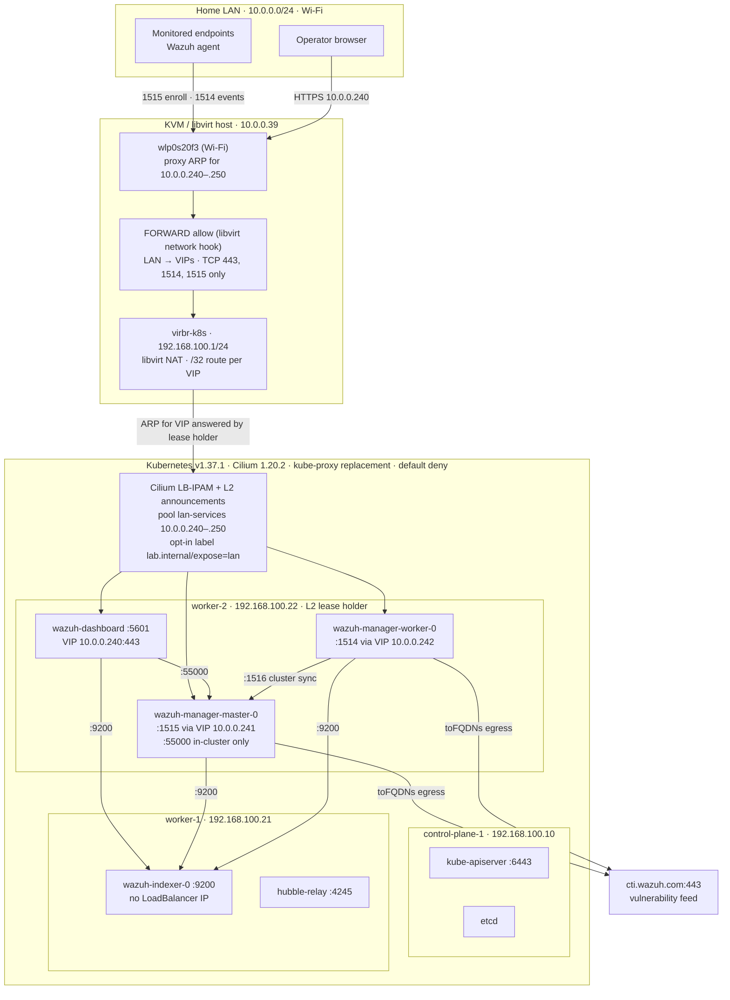

# Architecture and Trust Boundaries

## System Topology & Signal Flow

Pod placement, lease holders, and VIP assignments were observed on the live cluster on 2026-10-20.

---

## LAN exposure

The host's only LAN interface is Wi-Fi, which cannot bridge the VMs onto the home network: an 802.11 client may only send frames from its own associated MAC. The design therefore keeps the libvirt NAT network and joins the two layer-2 segments at layer 3 on the host.

1. A LAN client ARPs for a VIP such as `10.0.0.240`. The host answers on `wlp0s20f3` with its own MAC (proxy ARP, one entry per pool address).
2. The host routes the VIP to `virbr-k8s` through a `/32` route and forwards the packet only if it is from `10.0.0.0/24` and to TCP 443, 1514, or 1515. These rules sit above libvirt's NAT rules, which would otherwise reject new connections into the bridge.
3. On the bridge, the host ARPs for the VIP and the Cilium agent holding that Service's lease answers with its node's MAC.
4. Cilium's eBPF load balancer delivers the packet to the backend pod. `externalTrafficPolicy: Local` keeps the client's source IP, so the pod-level `fromCIDR` rule sees the real LAN address.

The host rules live in a libvirt network hook, so they are reapplied whenever `k8s-lab` starts, plus a NetworkManager dispatcher script that reapplies them when Wi-Fi reconnects. Both are installed by [`scripts/Ansible/kvm-host-lan.yaml`](../scripts/Ansible/kvm-host-lan.yaml).

| Signal | Source | LAN address | Pod destination | Filters, outermost first |
| :--- | :--- | :--- | :--- | :--- |
| **Dashboard** | Operator browser | `10.0.0.240:443` | `wazuh-dashboard:5601` | Host FORWARD, `loadBalancerSourceRanges`, Cilium `fromCIDR` |
| **Agent enrollment** | Monitored endpoints | `10.0.0.241:1515` | `wazuh-manager-master-0:1515` | Same three, then the enrollment password |
| **Agent events** | Monitored endpoints | `10.0.0.242:1514` | `wazuh-manager-worker-0:1514` | Same three, then the agent key (`client.keys`) |
| **Wazuh API** | Dashboard only | Not forwarded by the host | `wazuh-manager-master-0:55000` | Cilium: ingress from the dashboard only |
| **Indexer** | Dashboard and managers | None (Service not opted in) | `wazuh-indexer-0:9200` | Cilium: ingress from the dashboard and managers only |
| **Kubernetes API** | Admin workstation | SSH jump through `10.0.0.39` | `kube-apiserver:6443` | SSH keys, then mTLS (admin PKI) |
| **Flow telemetry** | Operator | `cilium hubble port-forward` | `hubble-relay:4245` | Port-forward enters the pod directly; relay ingress otherwise allows hubble-ui only |

---

## Network policy

Every Cilium endpoint in every namespace denies traffic in both directions unless a policy allows it, including namespaces created later. The allow rules were written from ten minutes of captured Hubble flows, then verified with positive and negative tests.

| Scope | Files in [`platform/cilium/`](../platform/cilium/) | What it allows |
| :--- | :--- | :--- |
| Cluster | `cluster-default-deny.yaml` | Nothing, except Cilium health probes between nodes |
| `kube-system` | `kube-system-allow.yaml` | CoreDNS from the cluster and to the upstream resolver; Hubble relay and UI |
| `local-path-storage` | `local-path-storage-allow.yaml` | Provisioner to the API server |
| `wazuh` | `wazuh-*.yaml` | The observed component flows above, LAN ingress on the three exposed ports, and egress to `cti.wazuh.com` by FQDN |
| `secops` | `secops-*.yaml` | Namespace DNS only |

DNS is allow-listed too: Wazuh pods resolve only their own Service and headless pod names, and only the managers can also resolve `cti.wazuh.com`. This closes DNS tunneling as an exfiltration path. FQDN egress matters here because the feed sits on CDN addresses shared with unrelated sites.

Policy covers pods, not the nodes themselves: the Cilium host firewall is off, and each node can still reach its own pods, which kubelet probes depend on.

---

## Components

- **VM layer:** durable hostnames and IPs, time synchronization, storage attachment, firewalling, patching, and snapshots.
- **Kubernetes layer:** kubeadm control plane, worker scheduling, RBAC, namespaces, Secrets, and StatefulSets.
- **Network layer:** Cilium CNI, kube-proxy replacement, policy enforcement, and Hubble flow telemetry.
- **Security operations layer:** Wazuh managers, indexer, dashboard, endpoint agents, custom detections, and response runbooks.
- **External policy layer:** Project 06 policy-as-code remains in the Cloud Operations repository.

## Trust boundaries

1. The Kubernetes API is an administrative boundary; administrator kubeconfigs are secrets.
2. The Wazuh dashboard is an operator boundary. It is reachable from the home LAN only, over TLS, and must use rotated credentials rather than the upstream examples.
3. Agent enrollment and event ingestion cross from monitored endpoints into the cluster. Source networks are restricted to the home LAN at three layers; the enrollment secret must still be rotated before untrusted devices share that LAN.
4. The indexer contains sensitive telemetry and is not exposed: its Service never receives a LoadBalancer IP because it lacks the opt-in label, and only the dashboard and managers may connect to it.
5. CSI storage and VM snapshots contain security data and credentials; encrypt and control both.
6. Upstream manifests enter through a pinned staging boundary and must be reviewed before application.

## Availability limits

The reference topology is a lab, not a high-availability design. One control-plane VM is a control-plane and etcd failure domain. Local persistent volumes may bind data availability to one worker. The docs require evidence of restore and rescheduling behavior before making resilience claims.
