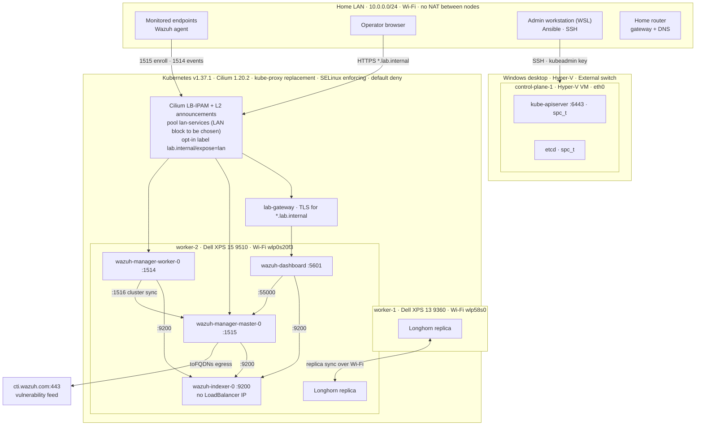

# Architecture and Trust Boundaries

## System Topology & Signal Flow



Node hardware, addresses, SELinux labels, and node health were observed on the live cluster on 2026-10-26. The Wazuh pods, Longhorn replicas, and LAN service addresses show the planned layout: they have not yet been redeployed on the hybrid cluster. Wazuh is placed on `worker-2` because it has the most memory.

---

## Nodes and the LAN

Every node has its own address on the home LAN, so the kubelets, the API server, etcd, and Cilium's tunnel reach each other directly.

| Node | Platform | LAN interface | Notes |
| :--- | :--- | :--- | :--- |
| `control-plane-1` | Hyper-V Generation 2 VM on the Windows desktop | `eth0` on an External switch bound to the desktop's Wi-Fi | Static memory, automatic checkpoints off (restoring one would roll etcd back), starts with Windows |
| `worker-1` | Dell XPS 13 9360, bare metal | Wi-Fi `wlp58s0` | Lid switch ignored, sleep targets masked, LUKS-encrypted disk |
| `worker-2` | Dell XPS 15 9510, bare metal | Wi-Fi `wlp0s20f3` | Same as worker-1; also has a 1 TB USB SSD, not used by the cluster |

[`scripts/Ansible/node-network.yaml`](../scripts/Ansible/node-network.yaml) pins each node's current DHCP address as a static NetworkManager address and points DNS at the home router. CoreDNS forwards to the node's resolver, and its Cilium policy allows only that router address.

Over Wi-Fi, Hyper-V rewrites the VM's MAC address so the bridge works. IPv4 and ARP work through it. The control plane is excluded from answering ARP for service addresses, so only the bare-metal workers do.

### What the hybrid design replaced

The first build ran every node as a libvirt VM behind NAT on a Wi-Fi laptop. An 802.11 client may only send frames from its own MAC, so the VMs could not be bridged, and a libvirt network hook DNATed the host's ports 443, 1514, and 1515 to service VIPs on the internal bridge. That layer is retired to [`archive/`](../archive/README.md). The former libvirt host is now `worker-2`.

---

## LAN exposure

1. A LAN client connects to a service VIP from the `lan-services` pool in [`platform/cilium/manifests/lb.yaml`](../platform/cilium/manifests/lb.yaml).
2. The client ARPs for the VIP. The Cilium agent on the worker holding that Service's lease answers with its own Wi-Fi MAC. If that worker goes down, the other takes the lease and the VIP moves with it.
3. Cilium's eBPF load balancer delivers the packet to the backend pod. `externalTrafficPolicy: Local` keeps the client's source IP, so the pod-level `fromCIDR` rule sees the real LAN address.

Only Services labelled `lab.internal/expose: lan` receive a VIP. The pool holds a single address, `10.0.0.56`, which the router never assigns; the Gateway in [`platform/gateway-api/gateway.yaml`](../platform/gateway-api/gateway.yaml) pins it, and Wazuh's agent ports can share it later with `lbipam.cilium.io/sharing-key`. The Gateway admits only the admin desktop, because the Longhorn UI behind it has no login.

| Signal | Source | LAN entry | Pod destination | Filters, outermost first |
| :--- | :--- | :--- | :--- | :--- |
| **Dashboard** | Operator browser | Gateway VIP `:443` (`wazuh.lab.internal`) | `wazuh-dashboard:5601` | Gateway TLS and HTTPRoute, Cilium `ingress` identity |
| **Agent enrollment** | Monitored endpoints | Enrollment VIP `:1515` | `wazuh-manager-master-0:1515` | `loadBalancerSourceRanges`, Cilium `fromCIDR`, then the enrollment password |
| **Agent events** | Monitored endpoints | Events VIP `:1514` | `wazuh-manager-worker-0:1514` | Same, then the agent key (`client.keys`) |
| **Wazuh API** | Dashboard only | Not exposed | `wazuh-manager-master-0:55000` | Cilium: ingress from the dashboard only |
| **Indexer** | Dashboard and managers | None (Service not opted in) | `wazuh-indexer-0:9200` | Cilium: ingress from the dashboard and managers only |
| **Kubernetes API** | Admin workstation | SSH to `control-plane-1`, `kubectl` on the node | `kube-apiserver:6443` | SSH keys, then mTLS (admin PKI) |
| **Flow telemetry** | Operator | `cilium hubble port-forward` | `hubble-relay:4245` | Port-forward enters the pod directly; relay ingress otherwise allows hubble-ui only |

---

## Network policy

Every Cilium endpoint in every namespace denies traffic in both directions unless a policy allows it, including namespaces created later. The allow rules were written from captured Hubble flows on the libvirt build, then verified with positive and negative tests. On the hybrid cluster they are re-applied one namespace at a time.

| Scope | File in [`platform/cilium/manifests/`](../platform/cilium/manifests/) | What it allows |
| :--- | :--- | :--- |
| Cluster | `cluster.yaml` | Nothing by default; Cilium health probes between nodes and Gateway API ingress through Envoy |
| `kube-system` | `kube-system.yaml` | CoreDNS from the cluster and to the home router; Hubble relay and UI; Metrics Server |
| `wazuh` | `wazuh.yaml` | The observed component flows above, LAN ingress on the exposed ports, and egress to `cti.wazuh.com` by FQDN |
| `longhorn-system` | `longhorn.yaml` | API server leases, CoreDNS, inter-pod engine/replica sync, and node-local iSCSI attachments |
| `cert-manager` | `cert-manager.yaml` | API server CRD sync, CoreDNS, and webhook validation ingress |
| `argocd` | `argocd.yaml` | In progress |
| LAN addresses | `lb.yaml` | The LoadBalancer IP pool and the L2 announcement policy (workers' Wi-Fi interfaces only) |

DNS is allow-listed too: Wazuh pods resolve only their own Service and headless pod names, and only the managers can also resolve `cti.wazuh.com`. This closes DNS tunneling as an exfiltration path. FQDN egress matters here because the feed sits on CDN addresses shared with unrelated sites.

Policy covers pods, not the nodes themselves: the Cilium host firewall is off and `firewalld` is disabled on the nodes. Because the nodes now sit directly on the home LAN, node services rely on their own authentication (see SG-12 in [`security-gaps.md`](security-gaps.md)).

---

## SELinux

SELinux is enforcing on every node, and containerd labels every container (`enable_selinux = true`), so pods run confined as `container_t`. The four kubeadm control-plane static pods must read `kubernetes_file_t` under `/etc/kubernetes`, which `container_t` may not, so kubeadm patches run only those pods as `spc_t` (Incident 7 in [`PROBLEM_SOLVED.md`](PROBLEM_SOLVED.md)). Privileged pods, such as Cilium's and Longhorn's node agents, get `spc_t` from containerd automatically.

---

## Unified Access Architecture: Gateway API, L2 Announcements & PKI

To provide a single entrypoint for all cluster services over valid HTTPS without memorizing arbitrary port numbers, the platform layers Cilium Gateway API on top of L2 Announcements and cert-manager:

```text
Layer 7 (Routing):   Hostnames (*.lab.internal)                     ◄── Cilium Gateway API (HTTPRoutes)
                                  │
Layer 4 (Security):  Port 443 HTTPS with trusted TLS certificates  ◄── cert-manager (lab-ca-issuer)
                                  │
Layer 3 (IP):        Gateway VIP on the home LAN                    ◄── Cilium LoadBalancer IP Pool
                                  │
Layer 2 (Hardware):  ARP announcements on the workers' Wi-Fi        ◄── Cilium L2 Announcements
```

### 1. The Gateway API Framework (CRDs)
Gateway API replaces legacy `Ingress` with role-oriented, declarative routing schemas. The latest supported version is v1 as released by the [v1.6.1 release](https://github.com/kubernetes-sigs/gateway-api/releases/tag/v1.6.1) of this project.
* **`GatewayClass`:** Binds the gateway engine to `cilium`.
* **`Gateway`:** The shared network listener binding one IP on port 443 with TLS termination.
* **`HTTPRoute`:** Decoupled, service-specific routing rules (e.g. `storage.lab.internal` $\rightarrow$ Longhorn, `wazuh.lab.internal` $\rightarrow$ Wazuh).
* **`ReferenceGrant`:** Cross-namespace security contract permitting the Gateway in `default` to reference certificates in other namespaces.

### 2. Private PKI (`cert-manager` & `lab-ca-issuer`)
* **Automated Certificate Lifecycle:** Eliminates manual OpenSSL commands and expiration outages.
* **Private Root CA (`lab-ca-issuer`):** A dedicated 10-year internal Root CA signs a wildcard certificate for `*.lab.internal`.
* **Zero Browser Warnings:** Importing the root CA certificate once into client workstations (Windows / Linux / macOS) provides green trusted padlocks across all internal services.

---

## Components

- **Host layer:** the Hyper-V VM and its Windows host, the bare-metal laptops (lid, sleep, and Wi-Fi power settings, LUKS unlock at boot), stable addresses, time synchronization, and patching.
- **Kubernetes layer:** kubeadm control plane, worker scheduling, RBAC, namespaces, Secrets, and StatefulSets.
- **Network layer:** Cilium CNI, kube-proxy replacement, policy enforcement, and Hubble flow telemetry.
- **Storage layer:** Longhorn, with one replica of each volume on each laptop.
- **Security operations layer:** Wazuh managers, indexer, dashboard, endpoint agents, custom detections, and response runbooks.
- **External policy layer:** Project 06 policy-as-code remains in the Cloud Operations repository.

## Trust boundaries

1. The Kubernetes API is an administrative boundary; administrator kubeconfigs are secrets.
2. The Wazuh dashboard is an operator boundary. It is reachable from the home LAN only, over TLS, and must use rotated credentials rather than the upstream examples.
3. Agent enrollment and event ingestion cross from monitored endpoints into the cluster. Source networks are restricted to the home LAN at two layers; the enrollment secret must still be rotated before untrusted devices share that LAN.
4. The indexer contains sensitive telemetry and is not exposed: its Service never receives a LoadBalancer IP because it lacks the opt-in label, and only the dashboard and managers may connect to it.
5. Longhorn replicas contain security data and credentials. They sit on the laptops' LUKS-encrypted disks, so they are encrypted at rest, but Longhorn does not encrypt replica traffic between the laptops.
6. The nodes share the home Wi-Fi with every other device, so node-level services are a boundary of their own (SG-02 and SG-12 in [`security-gaps.md`](security-gaps.md)).
7. Upstream manifests enter through a pinned staging boundary and must be reviewed before application.

## Availability limits

The topology is a lab, not a high-availability design. One control-plane VM is a control-plane and etcd failure domain, and it depends on the Windows desktop staying on. Longhorn keeps two replicas, one per laptop, so a volume survives one worker's loss but runs degraded until it returns. The laptops are powered off when the lab is idle and need their LUKS passphrase typed at each boot. The docs require evidence of restore and rescheduling behavior before making resilience claims.
